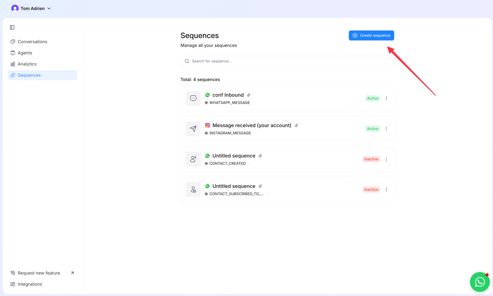
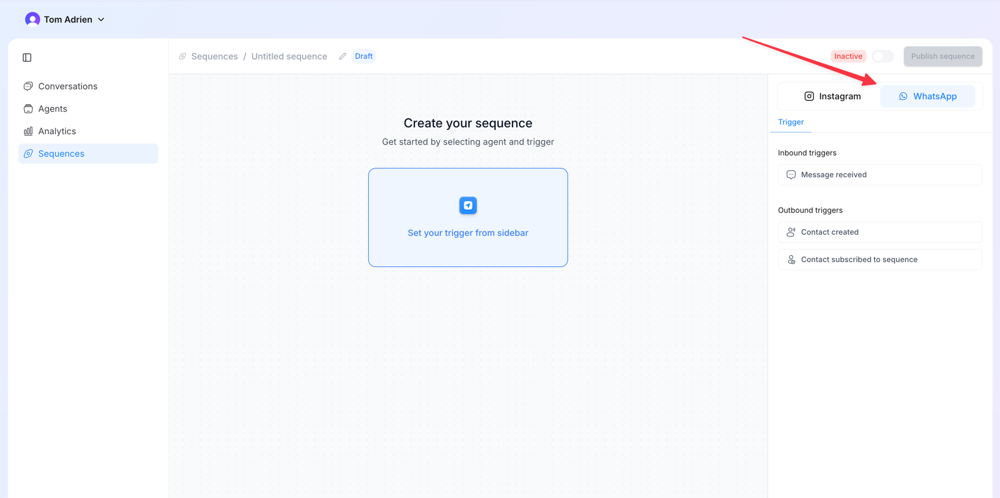
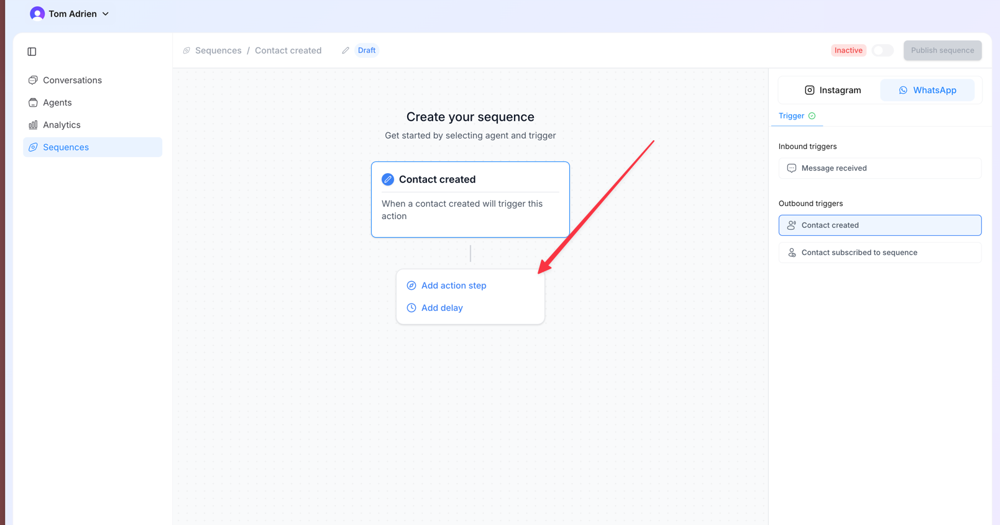
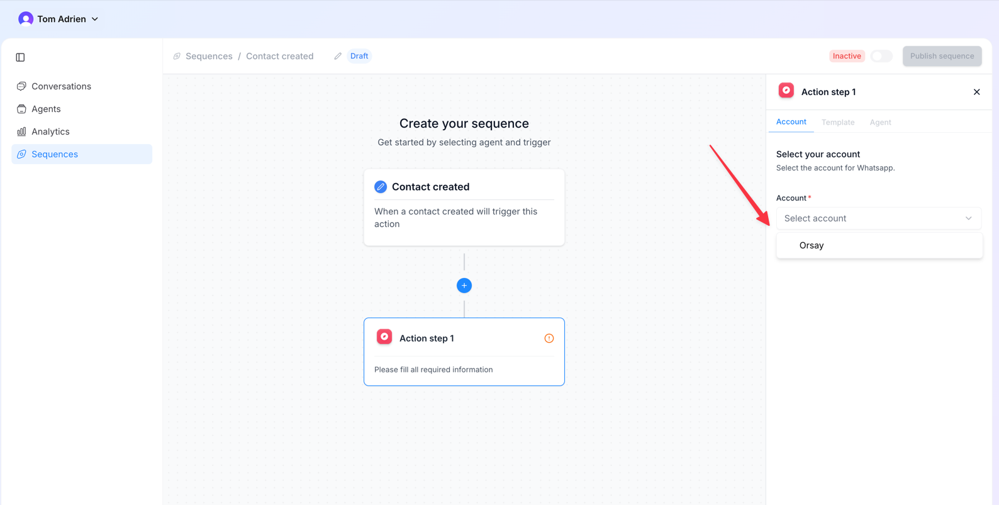
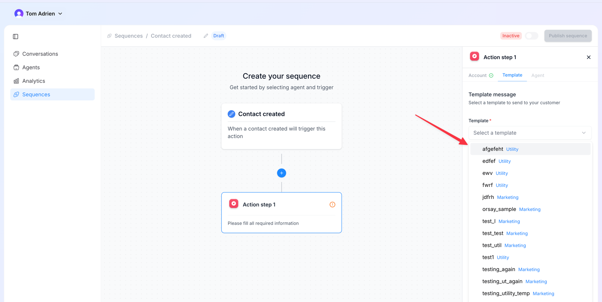
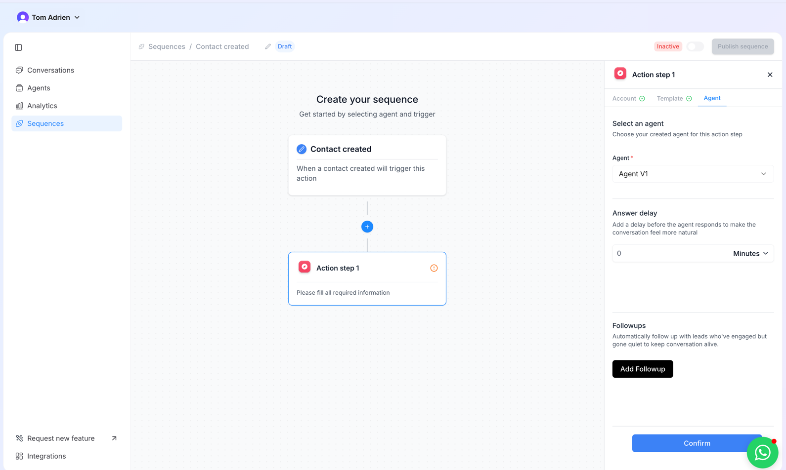
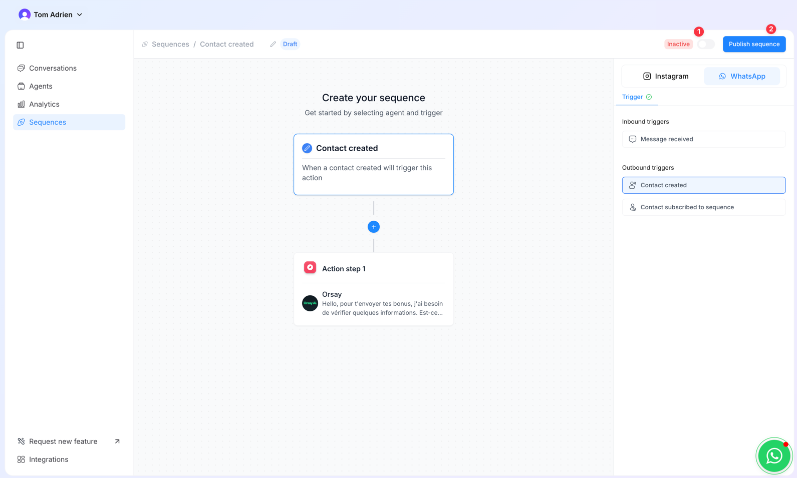

A **sequence** on the WhatsApp Business API always starts with an **approved template message** (Meta's rule). After the lead replies, the agent runs the rest of the conversation.

## Build a WhatsApp Business sequence

<Steps>
  <Step title="Create a new sequence">
    Go to **[Sequences](https://app.orsay.ai/sequences)** → **Create sequence**.
    
  </Step>
  <Step title="Pick WhatsApp">
    Select **WhatsApp** as the channel.
    
  </Step>
  <Step title="Choose a trigger">
    | Trigger | When it fires |
    |---|---|
    | **Message received** | Each time a new lead messages your number |
    | **Contact created** | For any new lead not already in another sequence |
    | **Contact subscribed to sequence** | For leads added to this sequence (CSV upload or Zapier) |
  </Step>
  <Step title="Add the first action step">
    Click **+** and **Add action step**.
    
    Select your **WhatsApp account**.
    
    Pick the **approved template message** and its language.
    
  </Step>
  <Step title="Attach the agent">
    Pick the agent. Set the **answer delay** and add **follow-ups** if needed, then click **Confirm**.
    
  </Step>
  <Step title="Toggle on and publish">
    Activate the sequence with the toggle and **publish**.
    
  </Step>
</Steps>

## The 24-hour rule

WhatsApp Business has a **24-hour messaging window**: after a lead replies, the agent can write freely for 24 hours. After that, you must send another approved template to re-open the conversation. Use **follow-ups** in the sequence to schedule template-based re-engagements at the right cadence.

## Bulk leads via CSV or Zapier

Got an existing lead list? Two ways to push them into a sequence:

- **CSV upload** — **[Integrations](https://app.orsay.ai/integrations) → [Bulk Leads](https://app.orsay.ai/integrations/bulk-leads) → Upload Files**. The sequence must use the **Contact subscribed to sequence** trigger.
- **Zapier** — connect your lead source (Facebook Ads, ClickFunnels, etc.) and route every new lead automatically. → covered in the next step.

## Next step

→ [4. Connect Zapier](/en/whatsapp-api/4-zapier)
