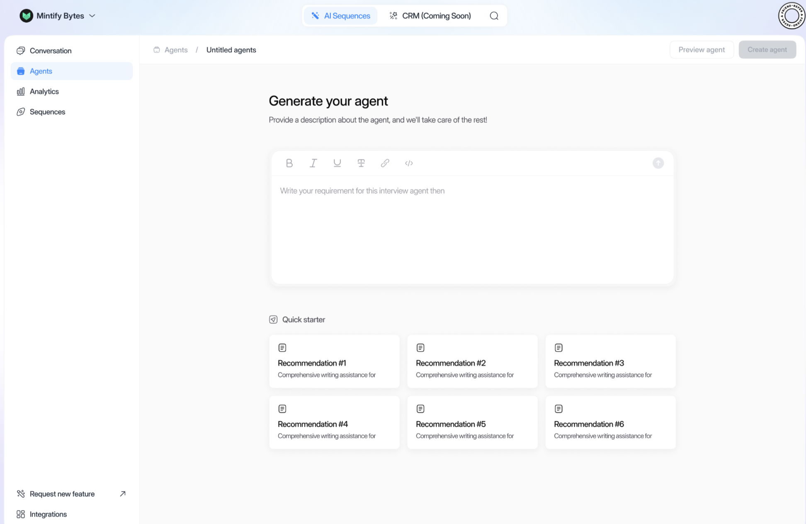

# Conseils pour les Prompts

Voici un guide concis pour créer des prompts efficaces pour générer votre agent.

<AccordionGroup>
  <Accordion title="💡 Conseils pour rédiger de bons prompts">
    
    1. **Soyez spécifique**
       - Incluez des instructions claires et concises.
       - Concentrez-vous sur l’objectif ou le comportement exact que vous souhaitez de l’agent.
    2. **Fournissez le contexte**
       - Décrivez brièvement votre entreprise, produit ou service.
       - Partagez toute information pertinente pour que l’IA réponde précisément.
    3. **Utilisez un langage simple**
       - Évitez le jargon ou les répétitions inutiles.
       - Rédigez des phrases courtes et directes.
    4. **Exposez les points clés**
       - Si vous avez plusieurs objectifs ou questions, listez-les clairement.
       - Cela aide l’IA à structurer sa réponse.
    5. **Proposez des exemples**
       - Si vous souhaitez un style particulier (amical, professionnel), donnez une ou deux phrases exemples.
       - Montrer le ton souhaité guide l’approche de l’IA.
  </Accordion>

{" "}

<Accordion title="🛫 Recommandations Quick Starter">
  Si vous ne savez pas par où commencer, cliquez sur l’une des tuiles de
  recommandations sous **“Quick starter”**. Chaque tuile contient un modèle de
  prompt prêt à l’emploi que vous pouvez adapter.
</Accordion>

  <Accordion title="🤖 Création de votre agent">
    1. **Rédigez votre besoin**
       - Dans la zone de texte, décrivez le but, le contexte et le ton souhaité pour votre agent.
    2. **Optionnel : utilisez Quick Starter**
       - Sélectionnez un prompt pré-écrit pour démarrer rapidement.
    3. **Aperçu de l’agent**
       - Cliquez sur **“Preview agent”** pour voir sa réponse. Ajustez le prompt si nécessaire.
    4. **Créer l’agent**
       - Une fois satisfait, cliquez sur **“Create agent”** pour finaliser.

    Suivre ces étapes permet de maximiser la clarté de vos prompts et d’assurer que votre agent engage efficacement vos leads.

  </Accordion>
</AccordionGroup>

# Créer votre propre Prompt

Voici un guide concis pour rédiger un prompt pour un agent commercial. Suivez ces bonnes pratiques pour que l’agent pose les bonnes questions, partage des informations claires sur le produit et inclue un appel à l’action avec un lien.

<AccordionGroup>
  <Accordion title="💪 Bonnes pratiques pour les prompts d’agent commercial">
    1. **Nommer votre agent IA**
       - Commencez par présenter brièvement l’agent et son rôle.
       - Exemple : “Je crée un agent commercial nommé **Bella** pour promouvoir notre logiciel marketing.”
    2. **Inclure les détails sur la marque et le produit**
       - Donnez les points importants sur votre entreprise et votre offre.
       - Exemple : “Notre société, **X-Mark Solutions**, propose un CRM cloud pour améliorer les conversions de leads.”
    3. **Questions de qualification**
       - Spécifiez les questions que l’agent doit poser pour comprendre les besoins du prospect.
       - Exemple :
         1. “Quel est votre principal défi en vente ?”
         2. “Combien de leads gérez-vous en moyenne par mois ?”
         3. “Êtes-vous intéressé par l’automatisation des campagnes de suivi ?”
    4. **Phrase d’appel à l’action**
       - Demandez à l’agent d’inviter directement le prospect à agir.
       - Exemple : “Souhaitez-vous en savoir plus sur la façon dont notre CRM peut doubler votre pipeline de ventes ?”
    5. **Confirmation avec lien**
       - Fournissez un lien pour réserver, s’inscrire ou demander une démo.
       - Exemple : “Super ! Veuillez cliquer sur ce lien pour planifier une démo de 15 minutes : [**YourDemoLink.com**](https://yourdemolink.com/).”
    6. **Exigences claires**
       - Utilisez des puces ou des phrases courtes pour expliquer chaque étape.
       - Gardez un ton direct, clair et orienté ventes.
  </Accordion>

  <Accordion title="Mettre le tout ensemble">
    **Exemple de prompt** (vous pouvez copier/coller et ajuster) :

    > “Créez un agent commercial nommé Bella pour X-Mark Solutions. L’agent doit :
    >
    > - Présenter brièvement notre **CRM cloud** et comment il aide à augmenter les conversions de leads.
    > - Poser 3 à 4 **questions de qualification** sur le processus de vente du prospect.
    > - Utiliser un **appel à l’action** direct pour inviter le prospect à en savoir plus.
    > - Fournir un **lien de confirmation** pour planifier une démo : [YourDemoLink.com](https://yourdemolink.com/).
    > - Maintenir un ton **clair, concis et orienté résultats** tout au long de la conversation.”

    1. **Collez votre prompt** dans la zone de texte.
    2. **Aperçu de l’agent** pour voir le flux de conversation.
    3. **Affinez** si nécessaire (questions, ton, CTA).
    4. **Créez votre agent** une fois satisfait.

    En suivant ces directives, votre **agent commercial IA** sera prêt à **qualifier les prospects**, communiquer clairement les **avantages produits**, et les **diriger vers la prochaine étape**.

  </Accordion>
</AccordionGroup>

[📝 Voici un exemple de prompt que vous pouvez utiliser](/fr/resources/prompt-template)
