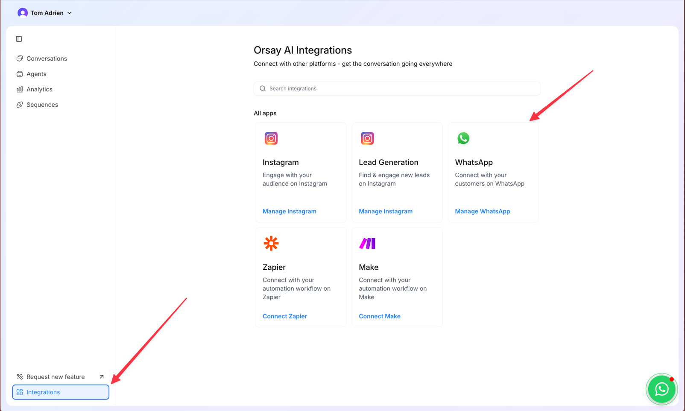
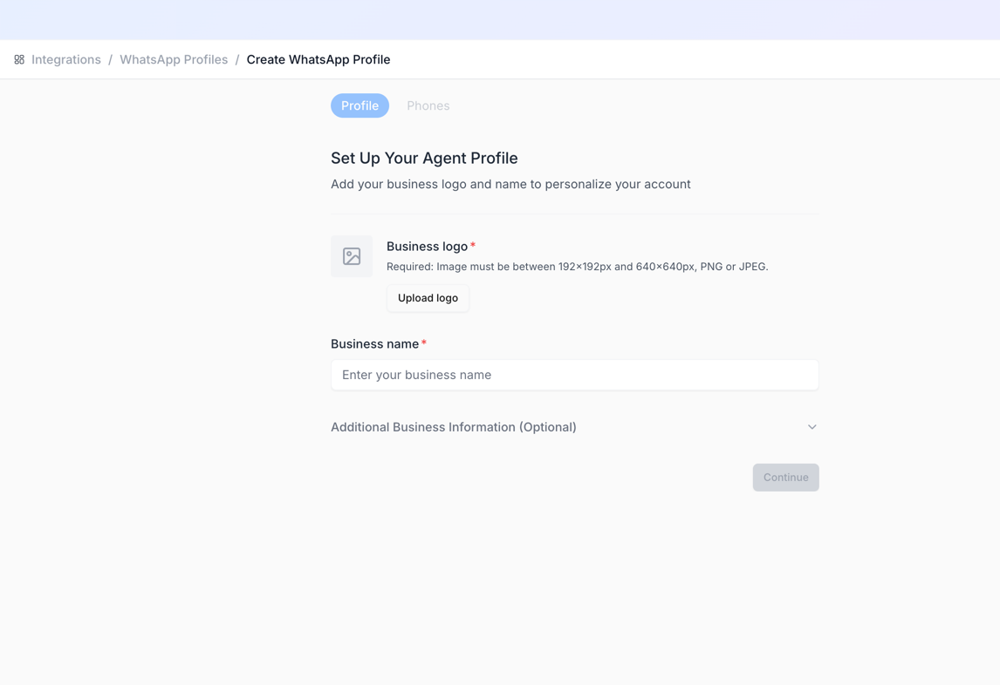
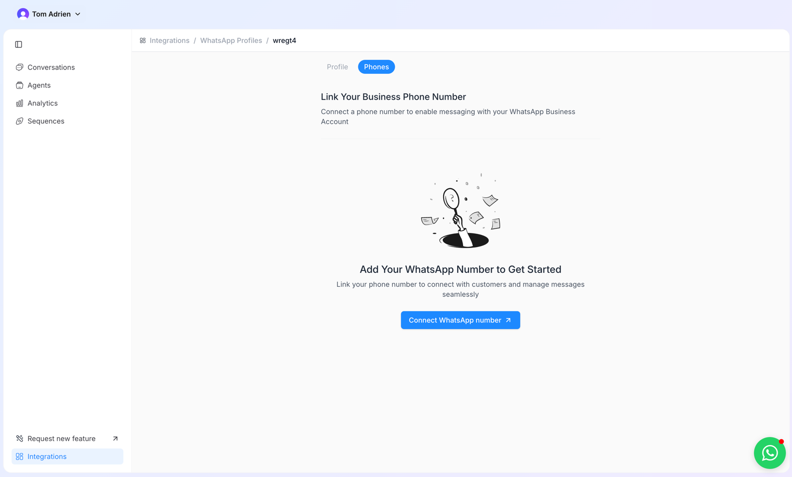
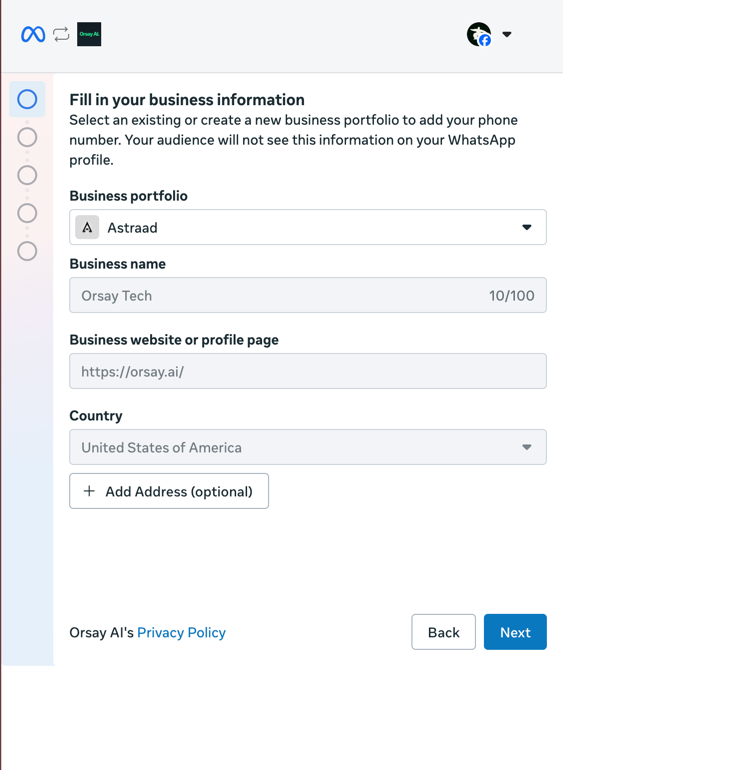
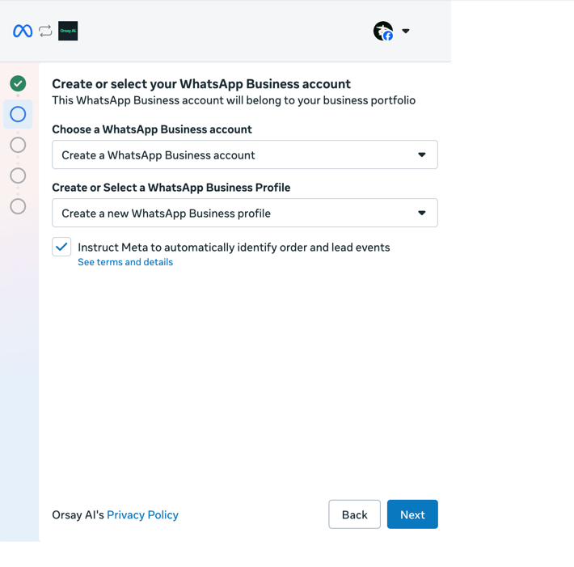
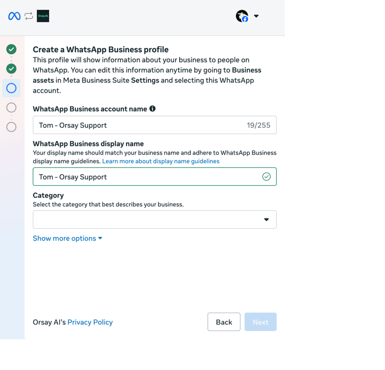
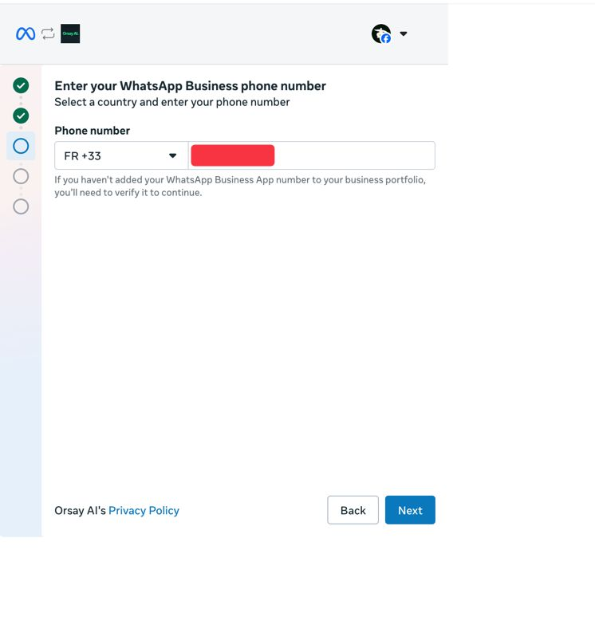
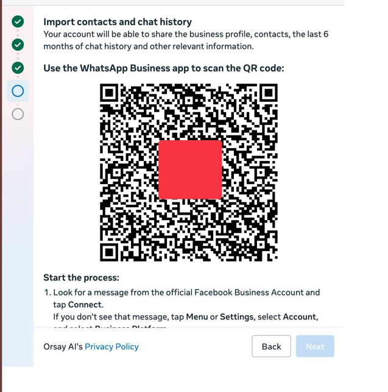
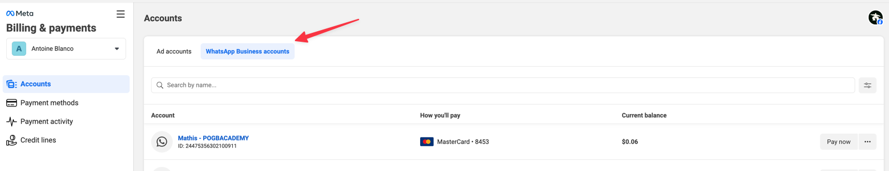
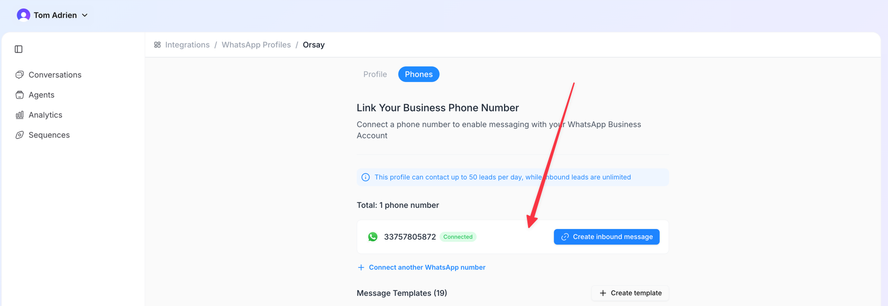

L'API WhatsApp Business est le canal officiel de Meta pour les entreprises. Elle nécessite un **compte WhatsApp Business vérifié (WABA)** et des **templates approuvés** pour envoyer le premier message — mais en échange, vous obtenez la pastille verte, pas de plafond quotidien et le support officiel de Meta.

<Note>
Vous avez **deux options** : créer un nouveau compte WhatsApp Business depuis zéro, ou connecter un compte WhatsApp Business existant que vous utilisez déjà.
</Note>

## Option A — Créer un nouveau compte WhatsApp Business

<Steps>
  <Step title="Ouvrez Intégrations → WhatsApp">
    Dans la barre latérale, cliquez sur **[Intégrations](https://app.orsay.ai/integrations)** → **[WhatsApp](https://app.orsay.ai/integrations/whatsapp)**.
    
  </Step>
  <Step title="Créez un profil">
    Ajoutez un nom et une photo de profil, puis cliquez sur **Connect a new WhatsApp number**.
    
    
  </Step>
  <Step title="Approuvez dans le Business Manager Facebook">
    Vous êtes redirigé vers Facebook. Approuvez les premières pages, puis sélectionnez votre **Business Manager**.
    
  </Step>
  <Step title="Créez un compte WhatsApp Business">
    Cliquez sur **Create a new WhatsApp Business Account**. Utilisez un nom au format **« Nom - Votre Entreprise »** (Meta exige ce format pour l'approbation).
    
    
  </Step>
  <Step title="Ajoutez un numéro de téléphone">
    Ajoutez un numéro **non lié à un compte WhatsApp existant**. Nous recommandons [On Off Business](https://onoffbusiness.com) pour obtenir un numéro propre rapidement. Validez avec le code 2FA reçu sur ce numéro.
  </Step>
</Steps>

## Option B — Connecter un WhatsApp Business existant

<Warning>
Cette option ne fonctionne que si votre téléphone utilise l'app **WhatsApp Business** — pas un compte WhatsApp personnel. (Pour WhatsApp personnel, utilisez plutôt le canal [WhatsApp Personnel](/fr/personal-whatsapp/1-connect).)
</Warning>

<Steps>
  <Step title="Lancez le même flow">
    Allez dans **[Intégrations](https://app.orsay.ai/integrations)** → **[WhatsApp](https://app.orsay.ai/integrations/whatsapp)** → créez un profil et cliquez sur **Connect WhatsApp number**.
  </Step>
  <Step title="Choisissez une app existante dans Facebook">
    Dans le flow Facebook, choisissez **Connect with existing WhatsApp Business App**.
    
  </Step>
  <Step title="Scannez et validez">
    Entrez votre numéro, scannez le QR code, et validez avec le code 2FA.
    
  </Step>
</Steps>

## Validez le numéro pour pouvoir envoyer

Avant de pouvoir envoyer des messages, Meta exige une méthode de paiement sur le compte WhatsApp Business.

<Steps>
  <Step title="Ajoutez une méthode de paiement">
    Allez sur [business.facebook.com/billing_hub](https://business.facebook.com/billing_hub), sélectionnez le bon business, ouvrez **WhatsApp**, et ajoutez une carte.
    
  </Step>
  <Step title="Envoyez un message TEST">
    Cliquez sur le bouton **TEST**, entrez votre WhatsApp personnel, et cliquez sur **SEND**. Si vous recevez le message, votre compte est prêt.
    
  </Step>
</Steps>

## Créez vos templates de messages

Les templates sont la **seule** façon de démarrer une conversation sur l'API WhatsApp Business (règle Meta). Une fois que le lead a répondu, l'agent peut écrire librement pendant 24h.

→ Créez des templates dans **[Intégrations](https://app.orsay.ai/integrations) → [WhatsApp](https://app.orsay.ai/integrations/whatsapp) → Templates**, soumettez pour approbation Meta (généralement quelques heures), puis utilisez-les dans votre séquence.

## Étape suivante

→ [2. Créer un agent](/fr/whatsapp-api/2-agent)
